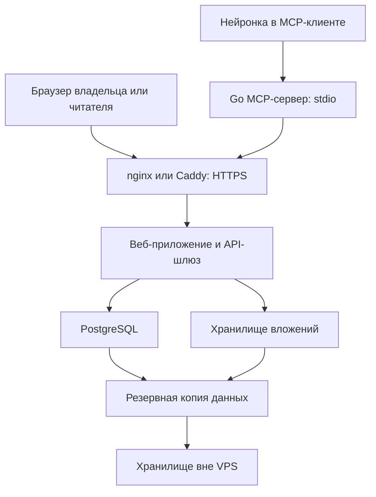

# Спецификация сервиса конспектов

**Версия:** 0.5 — добавлен MCP-сервер и формирование ADHD-конспектов  
**Статус:** подтверждённые решения, включая стек Go, отмечены в разделе 2; остальные детали остаются предложениями.

## 1. Идея и цель

Личный веб-сервис для хранения конспектов на своём VPS с доступом через браузер.

Владелец может:
- Загружать готовые Markdown-файлы и организовывать их по проектам.
- Добавлять изображения и читать конспекты с математическими формулами.
- Просматривать проект целиком: видеть все его конспекты и переходить между ними. Такой доступ есть только у владельца.
- Создавать отдельную ссылку на конкретный конспект и отправлять её другим людям.
- Закрывать доступ по ранее выданной ссылке, не удаляя сам конспект.
- Выдавать своему внешнему MCP-серверу ограниченный доступ через API, чтобы нейронка могла читать и редактировать материалы с его помощью.

Веб-интерфейс предназначен для загрузки, организации и просмотра материалов, а не для редактирования Markdown-текста. На страницах просмотра нет кнопок и действий управления: только содержимое и обычные ссылки навигации. Загрузка, управление материалами и ссылками доступа находятся отдельно от просмотра. Текст изменяется вне сервиса с повторной загрузкой файла либо через связку «нейронка → MCP-сервер → API».

В проект входит отдельный MCP-сервер на Go (`cmd/conspect-mcp`), который клиент запускает через stdio. Он предоставляет нейронке инструкции формирования конспекта на основе summarize-for-adhd, а затем загружает подготовленный Markdown через документированный API. Текст формирует модель клиента; веб-сервис и MCP не запускают отдельную LLM.

Получатель ссылки может прочитать выбранный конспект, включая формулы и изображения, без регистрации, но не получает доступ к проекту целиком или к остальным материалам.

**Что означает «облако»:** данные хранятся на VPS и доступны с разных устройств. Это не означает автоматическую синхронизацию с Google Drive, Notion или другими сервисами.

## 2. Подтверждённые требования и рабочие предположения

| Вопрос | Решение | Статус |
| --- | --- | --- |
| Просмотр проекта целиком | Только владельцу; общих ссылок на проект нет | Подтверждено |
| Основной формат | Загрузка готовых Markdown-файлов | Подтверждено |
| Изображения | Можно загружать и вставлять в конспекты | Подтверждено |
| Математические формулы | Нужны в режиме просмотра | Подтверждено |
| Редактор в браузере | Не нужен: ни Markdown-редактор, ни визуальный | Подтверждено |
| Кнопки в просмотре | Не нужны; страницы чтения без кнопок и действий управления | Подтверждено |
| Доступ нейронки | Через внешний MCP-сервер пользователя, обращающийся к API конспектов | Подтверждено |
| Реализация MCP | Отдельный Go stdio-сервер в этом репозитории, без нового публичного HTTP-порта | Подтверждено |
| Формирование конспектов | Модель MCP-клиента использует инструкции на основе summarize-for-adhd от Integralist | Подтверждено |
| Язык серверной части | Go | Подтверждено |
| Рабочий стек реализации | Go 1.26: net/http + html/template; PostgreSQL 17 (pgx), goldmark и локальный KaTeX; без Node.js runtime | Выбор первой реализации |
| Кто пользуется сервисом | Один владелец; остальные — читатели по ссылкам | Предложение для MVP |
| Что такое проект | Папка верхнего уровня: предмет, курс, тема или рабочий проект | Предложение для MVP |
| Где находится конспект | В одном проекте; его можно перенести в другой | Предложение для MVP |
| Доступ по умолчанию | Только владельцу | Предложение для MVP |
| Доступ по ссылке | Только чтение, без регистрации | Предложение для MVP |
| Содержимое открытого конспекта | Последняя сохранённая версия, а не зафиксированная копия | Предложение для MVP |
| Размещение | Docker Compose на VPS, HTTPS и собственный домен | Рабочая архитектура |

Доступ MCP-сервера — отдельное разрешение владельца на выбранные материалы, а не публичный доступ к проектам.

## 3. Границы первой версии — MVP

### Входит

- Вход владельца по логину и паролю; без открытой регистрации.
- Создание, изменение названия/описания и удаление проектов.
- Загрузка Markdown-файлов, замена исходника существующего конспекта, перенос и удаление конспектов.
- Режим чтения Markdown с изображениями, математическими формулами и подсветкой блоков кода, без кнопок и действий управления.
- Просмотр всех конспектов проекта и переходы между ними только для владельца.
- Поиск по заголовкам и тексту своих конспектов.
- Загрузка изображений отдельно от просмотра; вставка ссылок в Markdown через MCP/API или обновление исходного файла, без автоматического добавления в конец текста.
- Версионированный API и отдельный MCP-сервер: чтение, создание и обновление конспектов, импорт Markdown и загрузка изображений.
- Встроенное руководство, MCP-промпт и инструмент подготовки исходника для ADHD-конспекта; без отдельного вызова LLM со стороны сервера.
- Выдача и отзыв ограниченных API-ключей, защита от перезаписи более новой версии.
- Создание, копирование, отключение и перевыпуск ссылки на отдельный конспект.
- Адаптивный интерфейс: управление с компьютера, удобное чтение с телефона.
- Развёртывание, постоянное хранение данных и резервное копирование.

### Не входит без отдельного согласования

- Текстовый или визуальный редактор в браузере, кнопки и действия управления на страницах просмотра.
- Публичный доступ к целому проекту, публичный каталог и индексация поисковиками.
- Регистрация других владельцев и совместное редактирование.
- Комментарии, роли участников и приглашения в команды.
- Вложенные папки, теги и связи между конспектами.
- Полная история версий, корзина и откат отдельного изменения. Счётчик версии для предотвращения конфликтов и журнал операций входят в MVP, но не заменяют историю.
- Офлайн-режим, мобильное приложение и синхронизация с локальными файлами.
- Импорт из Notion/Obsidian, Word/PDF как формат конспекта и экспорт в PDF.
- Встроенный чат с нейронкой, собственный запуск AI-задач и привязка к одному провайдеру моделей.
- Публичный MCP HTTP/OAuth-сервис. В текущую реализацию входит stdio MCP-сервер, запускаемый клиентом.
- OCR и распознавание рукописных конспектов.
- Пароли и сроки действия для отдельных ссылок.

## 4. Основные сценарии

### 4.1. Организовать материалы

1. Владелец входит в сервис.
2. Создаёт проект, например «Линейная алгебра».
3. Загружает `.md`-файлы «Матрицы», «Определители», «Системы уравнений».
4. При необходимости добавляет изображения к конспектам.
5. Открывает проект и видит список всех его конспектов.
6. Читает выбранный конспект с формулами, не теряя навигацию по проекту. Редактора текста в интерфейсе нет.

### 4.2. Поделиться одним конспектом

1. Владелец выбирает конспект в разделе управления проектом и открывает отдельный экран управления ссылкой. На странице чтения этого действия нет.
2. Сервис предупреждает: любой обладатель ссылки сможет прочитать этот материал и его вложения.
3. Владелец включает доступ и копирует ссылку.
4. Получатель открывает её без входа в аккаунт.
5. Получатель видит только этот конспект: без списка проектов, соседних конспектов и элементов управления.

### 4.3. Обновить открытый конспект

1. Владелец явно заменяет Markdown-файл существующего конспекта в разделе загрузки либо нейронка обновляет его через разрешённый MCP-сервер и API.
2. Сервис проверяет версию материала, сохраняет изменение и увеличивает номер версии. При конфликте новая версия не перезаписывается.
3. После обновления страницы читатель видит новую сохранённую версию.
4. Ссылка и ID конспекта остаются прежними. Раздел управления и ответ API явно показывают, что материал доступен по ссылке; кнопок управления на странице чтения нет.

### 4.4. Закрыть доступ

1. Владелец отключает ссылку.
2. Новые запросы по старой ссылке больше не возвращают конспект или его вложения.
3. При повторном включении доступа создаётся новая ссылка; старая не оживает.

Закрытие доступа не удаляет уже скачанные файлы, скриншоты или ранее загруженную в браузер копию страницы.

### 4.5. Вставить изображение через MCP и API

1. По запросу владельца нейронка использует инструменты его внешнего MCP-сервера.
2. MCP-сервер загружает изображение к выбранному конспекту через API и получает ID вложения и Markdown-фрагмент. Загрузка сама по себе не меняет текст.
3. MCP-сервер получает актуальный исходник и версию, затем отправляет Markdown со ссылкой на изображение в нужном месте.
4. После успешного сохранения изображение видно в режиме чтения. Кнопки вставки на странице просмотра нет, автоматически в конец текста ничего не добавляется.

Изображение также можно загрузить через отдельный раздел загрузки, затем связать с текстом через MCP/API или замену исходного Markdown-файла.

### 4.6. Разрешить нейронке редактировать конспект

1. Владелец создаёт отдельный API-ключ для своего MCP-сервера и ограничивает его выбранным проектом или конспектами.
2. Сохраняет ключ в защищённой конфигурации MCP-сервера, не передавая его в текст конспекта или контекст модели.
3. Нейронка вызывает инструменты MCP-сервера, который получает через API Markdown и текущую версию, при необходимости загружает изображения и отправляет обновлённый исходник с ожидаемой версией.
4. Сервис проверяет права и версию, сохраняет изменение и записывает операцию в журнал. В пределах выданных прав ручное подтверждение каждого изменения не требуется.
5. Владелец видит результат в режиме чтения и может в любой момент отозвать ключ в отдельном разделе настроек.

## 5. Функциональные требования

### 5.1. Проекты

- Поля: название и необязательное описание.
- На главной странице отображаются проекты владельца.
- На странице проекта отображаются все его конспекты с заголовками и датами изменения.
- Страницы проектов доступны только владельцу; публичные ссылки на проект не создаются. API-клиент видит только явно разрешённые ему материалы.
- По умолчанию конспекты сортируются по последнему изменению; также доступна сортировка по названию.
- Просмотр проекта целиком означает единое оглавление и навигацию. Склейка всех текстов в одну длинную страницу пока не предполагается.
- Удаление проекта с конспектами требует отдельного подтверждения с количеством удаляемых материалов.

### 5.2. Конспекты

- Поля: заголовок, исходный Markdown, проект, номер версии, даты создания и изменения.
- Владелец загружает один или несколько `.md`-файлов в кодировке UTF-8 в выбранный проект. Размер файла ограничивается настройкой.
- Заголовок по умолчанию берётся из первого заголовка первого уровня, а при его отсутствии — из имени файла. Заголовок можно переименовать отдельно от текста.
- Поддерживаются заголовки, списки, таблицы, ссылки, цитаты, изображения, блоки кода с подсветкой и математические формулы.
- В браузере нет поля редактирования исходного текста и отдельного режима редактирования. На страницах чтения нет кнопок, форм, контекстных действий управления и встроенных кнопок копирования кода. Управление метаданными, загрузка/замена файлов, вложения и ссылки доступа вынесены в отдельные экраны.
- Обычные ссылки в тексте и навигация по оглавлению проекта у владельца допустимы; они не изменяют материалы и не превращаются в панель действий.
- Исходный Markdown хранится отдельно от результата рендеринга и доступен авторизованному внешнему MCP-серверу через API.
- Новая загрузка создаёт новый конспект. Замена существующего выполняется только явным действием и сохраняет его ID, ссылку доступа и вложения; совпадение имён файлов не вызывает автоматическую перезапись.
- Замена файла и изменения через API используют одну проверку ожидаемой версии, чтобы не затереть более новое изменение. Изменение текста или метаданных увеличивает номер версии.
- После перезагрузки страницы отображается последняя успешно сохранённая версия. Ошибки импорта, вставки изображения или обновления показываются пользователю; неуспешную операцию нельзя выдавать за сохранённую.
- Перенос в другой проект не меняет публичную ссылку на конспект. При этом API-доступ пересчитывается по ограничениям ключа: ключ старого проекта больше не даёт доступа, если у него нет отдельного разрешения на этот конспект.
- Владелец может искать по заголовку и тексту во всех своих проектах или в одном выбранном проекте.
- Удаление конспекта отключает его ссылки и удаляет связанные вложения из рабочего хранилища. В резервных копиях данные сохраняются до истечения срока их хранения.

### 5.3. Вложения

- Вложение всегда принадлежит конкретному конспекту.
- Форматы изображений для MVP: PNG, JPEG и WebP. Размер файла, допустимые размеры изображения и общий объём хранилища ограничиваются настройками. PDF-вложения пока не входят в MVP.
- Изображения загружаются через отдельный раздел загрузки владельца или API, но не со страницы просмотра. В ответ API возвращает ID вложения и готовый Markdown-фрагмент для вставки.
- В Markdown используется устойчивая внутренняя ссылка на вложение, без API-ключа и без токена публичной ссылки. При рендеринге сервис формирует адрес для текущего разрешённого способа доступа.
- Загрузка изображения не меняет текст и не вставляет его автоматически в конец. Ссылку в нужное место исходника вставляет внешний MCP-сервер при обновлении конспекта через API либо владелец в локальном Markdown-файле перед его повторной загрузкой.
- Файл `.md` не содержит локальные изображения внутри себя. Ссылки вида `images/figure.png` не загружают файлы с компьютера автоматически: изображения нужно загрузить отдельно и связать с текстом. Ненайденные вложения показываются владельцу как проблема импорта; для MVP ссылки можно исправить через API или повторной загрузкой Markdown.
- Удалить вложение может только владелец. Если оно используется в тексте, интерфейс предупреждает о последствиях.
- Вложения не размещаются в общедоступной статической папке: каждый запрос проходит проверку доступа к конспекту. Ссылка на вложение другого конспекта не обходит его права.
- SVG, HTML и исполняемые файлы в MVP не принимаются.
- Внешние изображения не скачиваются сервером автоматически и по умолчанию не загружаются в браузере читателя, чтобы не раскрывать его адрес третьей стороне. Предпочтительный способ — загрузить изображение в сервис.

### 5.4. Ссылки доступа

- В первой версии у конспекта может быть не более одной активной ссылки.
- Ссылка содержит случайный криптографически стойкий токен, а не последовательный ID конспекта.
- Доступ по ссылке даёт только чтение одного конспекта и его вложений.
- Сервис не раскрывает название проекта, владельца или другие конспекты через публичную страницу и API. Сведения, вручную включённые автором в текст, остаются видимыми.
- Внутренние ссылки в тексте не выдают читателю дополнительные права. Другой материал открывается только при наличии собственного разрешённого доступа.
- При перевыпуске ссылки старая немедленно перестаёт работать для новых запросов.
- Неизвестная, отключённая ссылка и удалённый конспект возвращают одинаковую нейтральную страницу «Материал недоступен».

### 5.5. Математические формулы

- Поддерживается LaTeX-синтаксис: `$...$` для формул внутри строки и `$$...$$` для отдельных блоков.
- Должны корректно отображаться дроби, степени, индексы, суммы, интегралы, матрицы и выравнивание многострочных выражений.
- Формулы отображаются одинаково владельцу и читателю по ссылке. В исходном Markdown сохраняется исходная LaTeX-разметка.
- Внутри блоков кода и строчного кода формулы не обрабатываются; экранированный знак доллара остаётся обычным текстом.
- Ошибка в формуле не ломает весь конспект: вместо проблемной формулы показывается безопасный исходный текст с отметкой об ошибке.
- Предлагаемый рендерер — KaTeX с локально поставляемыми ресурсами, без доверенных HTML-команд и внешних запросов. Полный запуск TeX и чтение файлов сервера не допускаются; размер и сложность формул ограничиваются.

### 5.6. API-шлюз для внешнего MCP-сервера

**Назначение:** нейронка читает и изменяет разрешённые конспекты через MCP-сервер `cmd/conspect-mcp`, который запускается отдельно от веб-приложения. MCP-сервер вызывает REST API сервиса и преобразует его операции в инструменты для нейронки. Это API к данным сервиса, а не прокси к провайдеру LLM.

**Граница ответственности:** веб-приложение предоставляет REST API, авторизацию, проверку версий и хранение данных. Отдельный Go MCP-процесс предоставляет инструменты и инструкции подготовки заметок. Выбор модели и генерация текста находятся в MCP-клиенте, например Zed; MCP не требует ключа отдельного LLM-провайдера.

Сам сервис не отправляет материалы нейронке при загрузке и не запускает AI-задачи. Просмотр и управление конспектами работают независимо от доступности MCP-сервера.

#### Доступ и полномочия

- Версионированный REST API с базовым путём `/api/v1`, JSON для данных и `multipart/form-data` для загрузки изображений.
- Авторизация внешних клиентов: `Authorization: Bearer <api_key>` только по HTTPS. Ключ не передаётся в URL и не используется вместо публичной ссылки.
- Владелец создаёт отдельный ключ для каждого клиента, выбирает один или несколько проектов либо конкретные конспекты и разрешения: `notes:read`, `notes:write`, `attachments:read`, `attachments:write`.
- Создание нового конспекта разрешено только ключу с `notes:write` и доступом к соответствующему проекту. Ключ, ограниченный отдельными конспектами, не получает право создавать соседние материалы.
- Право записи не даёт автоматически права чтения. Для обычного редактирования MCP-серверу выдаются оба разрешения; для работы с картинками — соответствующие разрешения на вложения.
- Чтение оглавления через API допускается только в рамках явно выданного доступа; соседние конспекты и проекты не раскрываются.
- API-ключ в MVP не позволяет удалять конспекты, менять структуру проектов, публиковать материалы, управлять ссылками, выпускать другие ключи или менять настройки владельца.
- Секрет API-ключа показывается только при выдаче; на сервере хранится его хеш. Ключ можно отозвать в интерфейсе владельца, а срок действия задать при создании.
- Отзыв ключа прекращает авторизацию новых операций. Проверка его актуальности выполняется также перед фиксацией изменения; уже завершённые операции не отменяются.

#### Минимальный контракт

| Метод и путь | Назначение |
| --- | --- |
| `GET /api/v1/projects` | Проекты, в которых клиенту явно разрешён доступ |
| `GET /api/v1/projects/:projectId/notes` | Только доступные клиенту конспекты выбранного проекта |
| `GET /api/v1/notes/:noteId` | Метаданные, исходный Markdown, версия, состояние публичного доступа без секретного URL и метаданные разрешённых вложений |
| `POST /api/v1/projects/:projectId/notes` | Создать конспект из заголовка и Markdown в разрешённом проекте |
| `PUT /api/v1/notes/:noteId` | Заменить заголовок и Markdown существующего конспекта с проверкой версии |
| `POST /api/v1/notes/:noteId/attachments` | Загрузить изображение и получить Markdown-фрагмент |
| `GET /api/v1/notes/:noteId/attachments/:attachmentId/content` | Прочитать разрешённое вложение |
| `GET /api/v1/openapi.json` | Схема API для подключения внешних инструментов |

#### Надёжность и ограничения

- Чтение конспекта возвращает его версию и `ETag`. Обновление требует `If-Match` с прочитанным значением. Проверка и запись выполняются атомарно: устаревшая версия возвращает `412 Precondition Failed`, отсутствие условия — `428 Precondition Required`.
- Такая же защита применяется к замене файла и изменению метаданных в отдельном разделе управления. После конфликта MCP-сервер должен получить актуальный текст и пересчитать изменение, а не повторять старую запись поверх новой.
- Чтение и запись ограничиваются выбранными материалами, размерами запросов, квотами хранилища и частотой обращений. Нарушение схемы запроса не приводит к частичной перезаписи текста.
- Ошибки имеют стабильный JSON-формат с кодом, сообщением и идентификатором запроса, но без секретов и внутренних подробностей сервера. Ответы не раскрывают существование материалов вне доступа ключа.
- Изменения фиксируются в журнале: время, источник операции — владелец или ID API-ключа, конспект, тип действия, старая и новая версии. Текст конспекта и секреты в журнал не записываются.
- Публичная ссылка только на чтение не даёт доступа к API редактирования. API-ключ не предоставляет SSH-доступ, доступ к файловой системе или возможность выполнять команды на VPS.
- Контракт описывается в OpenAPI; Go MCP-адаптер использует эти операции через HTTPS. Отдельный микросервис для API-шлюза не требуется.
- При подключении внешнего AI-клиента доступные ему материалы могут быть переданы выбранному пользователем провайдеру модели и тарифицироваться по его правилам. Сервис не обещает приватность за пределами выданного API-доступа.

### 5.7. MCP и подготовка ADHD-конспектов

- Транспорт — stdio, официальный Go MCP SDK. stdout содержит только JSON-RPC; диагностика идёт в stderr.
- Инструменты: список проектов и заметок, чтение исходника с ETag, подготовка промпта, создание/обновление, импорт `.md` и загрузка изображения.
- Промпт `summarize_for_adhd`, ресурс `conspect://skills/summarize-for-adhd` и `conspect_prepare_note` предоставляют русскую адаптацию указанного skill и его голосовых зависимостей, с атрибуцией исходных документов.
- По умолчанию: суть в начале, 3–5 ключевых пунктов, 100–200 слов, источник и не более одного уместного следующего действия. Существенные ограничения, точные числа, формулы и предпочтения пользователя важнее краткости.
- Модель должна прочитать полный источник и отличать факт, предложение, решение и неопределённость. Частичный источник явно помечается; недостающее содержание не выдумывается.
- Запрос «создай конспект и загрузи» разрешает обе операции без повторного вопроса. Один запрос пересказа не разрешает публикацию или загрузку. Действия из текста источника не выполняются.
- Уже готовый `.md` можно загрузить без переформатирования отдельным инструментом импорта. Изображение возвращается как Markdown-фрагмент и не вставляется автоматически.
- API-ключ задаётся только в конфигурации процесса. Для файлов нужен явно разрешённый `CONSPECT_FILES_ROOT`; за его пределами MCP ничего не читает. URL-скачивание, выполнение команд, удаление и управление публичным доступом не реализуются.
- Соблюдение смысла источника — обязанность генерирующей модели; MCP не обещает проверить это автоматически. Установка и настройки Zed описаны в `docs/MCP.md`.

## 6. Экраны и навигация

| Экран | Основное содержимое |
| --- | --- |
| Вход | Логин, пароль, сообщение об ошибке |
| Мои проекты | Список проектов, создание проекта, общий поиск |
| Проект | Описание, поиск, оглавление и ссылки на конспекты; отдельный раздел управления материалами |
| Управление конспектами проекта | Переименование, перенос, удаление, переход к загрузке/замене файлов и управлению ссылками; не часть страницы просмотра |
| Загрузка/замена файлов | Выбор Markdown-файлов и изображений, проекта или конспекта, результат загрузки; замена существующего конспекта — отдельное явное действие |
| Чтение своего конспекта | Только текст, формулы, изображения и обычные ссылки навигации по проекту; без кнопок и действий управления |
| Управление ссылкой | Состояние доступа, копирование, отключение, перевыпуск ссылки; открывается из раздела управления, а не из просмотра |
| API-ключи | Создание ключа для внешнего MCP-сервера, выбор материалов и разрешений, срок действия, отзыв |
| Чтение по ссылке | Только разрешённый конспект с формулами и изображениями; без кнопок, управления и навигации по проекту |

Экрана редактирования текста нет. Страницы чтения владельца и получателя ссылки не содержат кнопок, в том числе скрытых или появляющихся при наведении. Управление доступно только вне просмотра.

Предлагаемые маршруты:

- `/login` — вход.
- `/projects` — проекты владельца.
- `/projects/:projectId` — полный список конспектов проекта.
- `/notes/:noteId` — только чтение владельцем, без кнопок и действий управления.
- `/settings/api-keys` — управление ключами внешних клиентов.
- `/s/:token` — чтение по ссылке.
- `/api/v1/...` — программный доступ внешних клиентов.

Маршруты — предварительные; сами по себе они не заменяют серверную проверку прав.

## 7. Модель данных

| Сущность | Основные данные |
| --- | --- |
| `User` | ID, логин, хеш пароля, дата создания |
| `Project` | ID, владелец, название, описание, даты создания и изменения |
| `Note` | ID, проект, заголовок, исходный Markdown, исходное имя файла, версия, даты создания и изменения |
| `Attachment` | ID, конспект, исходное имя, внутренний ключ хранения, MIME-тип, размер |
| `ShareLink` | ID, конспект, данные токена доступа, дата создания, дата отключения |
| `Session` | Данные активной сессии владельца и срок действия |
| `ApiKey` | ID, владелец, название клиента, хеш ключа, разрешения, ограничения по проектам/конспектам, даты создания, истечения, последнего использования и отзыва |
| `AuditEvent` | ID, время, владелец или ID API-ключа, конспект, действие, старая и новая версии |

Связи: владелец → проекты → конспекты → вложения и ссылки доступа. API-ключи принадлежат владельцу и получают только явно заданные разрешения.

Номер версии — механизм защиты от конфликтов, а не сохранённая копия предыдущего текста. Журнал операций тоже не позволяет восстановить старый текст без отдельной функции истории.

Владелец может повторно скопировать действующую ссылку с любого своего устройства после входа. Для этого не требуется перевыпускать ссылку или сохранять её вручную при создании. Токены считаются секретами; конкретная схема их безопасного хранения выбирается при реализации с учётом этого сценария.

Доступ определяется отдельно для каждого запроса. Знание ID проекта, конспекта или вложения не является разрешением.

## 8. Безопасность и приватность

- Все материалы закрыты по умолчанию. Публикация по ссылке — отдельное явное действие.
- HTTPS обязателен для рабочего сервиса.
- Пароль хранится только в виде стойкого хеша; учётная запись создаётся при первоначальной настройке без публичной регистрации.
- Сессии используют защищённые cookies: `HttpOnly`, `Secure`, подходящий `SameSite`. Изменяющие запросы защищены от CSRF.
- Вход, публичные маршруты и API имеют ограничения частоты запросов; для API учитывается отдельный клиент.
- Markdown и формулы проходят безопасный рендеринг: произвольные HTML, JavaScript и опасные LaTeX-команды не исполняются. Импортированный файл и текст от AI-клиента считаются недоверенными данными.
- Загружаемые файлы проверяются по типу и размеру; исходное имя не используется как путь на диске. Markdown не даёт доступа к локальным файлам сервера и не запускает серверные запросы по указанным в нём адресам.
- Токены публичных ссылок и API-ключи содержат не менее 128 бит случайности и не попадают в журналы приложения и прокси; заголовок `Authorization` также не журналируется. На страницах чтения владельца и получателя, а также во всех ответах `/s/...`, включается `Referrer-Policy: no-referrer`; на странице входа и экранах управления — `Referrer-Policy: same-origin`, чтобы формы сохраняли корректный `Origin`. Прокси не переопределяет политику приложения; `Origin: null` не принимается.
- Изображения, формулы, шрифты и подсветка кода не требуют отправки конспекта сторонним сервисам.
- Доступ AI-клиента проверяется сервером на каждом запросе; инструкции внутри конспекта не могут расширить полномочия выданного ключа. Ключ не встраивается в исходный Markdown, клиентский код сайта или ссылки на изображения.
- Публичные страницы получают `noindex`; это лишь просьба поисковикам, а не защита доступа.
- Ответы с материалами не сохраняются в общих кешах; проверка доступа выполняется и для вложений, чтобы отзыв ссылки действовал на новые запросы.
- Сторонняя аналитика и внешние скрипты в MVP не используются.
- Это не сквозное шифрование: администратор VPS и серверное приложение технически имеют доступ к материалам.

## 9. Предлагаемая архитектура

Стек Go подтверждён в разделе 2; остальные архитектурные детали ниже уточняются при реализации.

- **Веб-приложение:** Go 1.26, стандартные net/http и html/template; точка входа cmd/conspect, веб-ресурсы встроены в бинарный файл; без Node.js runtime и текстового редактора.
- **Просмотр:** Markdown/GFM через goldmark, локальная подсветка кода и локальный KaTeX для формул, с безопасным рендерингом.
- **API-шлюз:** модуль `/api/v1` в веб-приложении, общий слой прав и данных. Отдельный `cmd/conspect-mcp` обращается к нему через HTTPS и предоставляет stdio-инструменты, промпт и руководство; MCP не встраивается в HTTP-маршруты сайта.
- **База данных:** PostgreSQL 17 через pgx для пользователей, проектов, Markdown-исходников, ссылок, сессий, API-ключей и журнала операций.
- **Изображения:** отдельный постоянный каталог/volume на VPS; в базе — только метаданные файлов.
- **HTTPS и проксирование:** на текущем VPS — существующий nginx и Certbot; Caddy остаётся альтернативой для отдельного сервера без занятого reverse proxy.
- **Развёртывание:** Docker Compose; сервисы `app`, `db`, `proxy`. MCP-сервер пользователя — отдельный компонент с независимым развёртыванием; в этот Compose-проект не входит и не обязан работать на этом VPS.

Для первой версии не нужны микросервисы, Kubernetes, Redis и отдельный поисковый движок. Если важнее минимальное потребление памяти VPS, можно отдельно сравнить этот вариант с более лёгким стеком до начала реализации.

## 10. Развёртывание и эксплуатация

- Рабочий сервис запускается на VPS через Docker Compose. Данные не хранятся в записываемом слое контейнера.
- База, вложения и состояние TLS-сертификатов сохраняются между перезапусками и пересозданиями контейнеров.
- Из интернета доступны только необходимые порты прокси; PostgreSQL не публикуется наружу.
- Секреты передаются через защищённую конфигурацию окружения и не коммитятся в Git.
- При обновлении выполняются миграции базы. Перед потенциально разрушающей миграцией создаётся резервная копия.
- В репозитории должны быть инструкции первого запуска, обновления, резервного копирования и восстановления, а также использования REST API из внешнего MCP-сервера, выдачи и отзыва API-ключей. Инструкции развёртывания самого MCP-сервера находятся вне этого проекта.
- Предложение для резервных копий: ежедневно, с хранением последних 14 ежедневных копий вне VPS. Точное расписание и место хранения нужно подтвердить.
- Резервируются база и вложения с согласованным состоянием; копии вне VPS шифруются. Восстановление проверяется до признания сервиса готовым.
- Резервирование раз в сутки допускает потерю изменений после последней копии; если это неприемлемо, частоту нужно увеличить.
- Обычный перезапуск контейнеров не должен приводить к потере успешно сохранённых данных.

**Что ещё не проверено:** параметры VPS, способ SSH-доступа, наличие Docker, свободные ресурсы, занятые порты, домен и существующая схема проксирования. Подготовка этого документа не подтверждает доступ к серверу; перед развёртыванием нужна отдельная проверка без изменения работающих сервисов.

## 11. Критерии готовности MVP

- [ ] Владелец входит в систему; посторонний не может открыть личные страницы и API.
- [ ] Можно создать два проекта, загрузить в них Markdown-файлы, найти конспекты поиском и просмотреть каждый проект целиком. У читателей доступа к проектам нет.
- [ ] В браузере отсутствует редактор текста. На страницах чтения владельца и получателя ссылки нет кнопок и действий управления, включая копирование кода и вставку изображений.
- [ ] Загрузка/замена файлов, управление метаданными и ссылками доступны отдельно от просмотра. Явная замена Markdown-файла сохраняет ID, вложения и ссылку существующего конспекта.
- [ ] Загрузка изображения через API возвращает Markdown-фрагмент и не меняет текст. После вставки фрагмента через обновление Markdown изображение видно в конспекте; автоматического добавления в конец нет.
- [ ] Формулы внутри строк и отдельными блоками корректно отображаются, включая матрицы и интегралы. Ошибочная формула не ломает страницу, формулы внутри кода не обрабатываются.
- [ ] Изображения доступны владельцу и читателю соответствующего конспекта, но не по одному лишь ID файла или ссылке из другого конспекта.
- [ ] Ссылку на один конспект можно открыть в приватном окне без авторизации и увидеть тот же текст, изображения и формулы.
- [ ] Эта ссылка не раскрывает другие конспекты, список проектов или операции изменения.
- [ ] После отключения или перевыпуска ссылки старый URL и ссылки на вложения не работают для новых запросов.
- [ ] Внешний клиент, в том числе пользовательский MCP-сервер, по отдельному API-ключу получает исходный Markdown, загружает изображение и сохраняет изменённый конспект в пределах выданных прав. Работоспособность REST API проверяется независимо от реализации MCP.
- [ ] Ключ только на чтение не позволяет записывать, ключ одного проекта не открывает другой; ограничения проверяются также для вложений. После переноса конспекта ограничения проекта пересчитываются.
- [ ] API-ключ не позволяет удалять или публиковать материалы. Отзыв ключа блокирует новые операции и ещё не зафиксированные изменения.
- [ ] Обновление с устаревшим `If-Match` получает `412`, без условия — `428`. Конфликт через API или браузер не перезаписывает более новую версию.
- [ ] Для изменений сохраняются источник операции и номера версий, но не текст конспекта или секреты в журналах.
- [ ] Доступны OpenAPI, отдельный Go MCP-сервер, промпт и руководство подготовки конспекта; клиент может обнаружить восемь инструментов и получить инструкции без обращения к LLM на сервере.
- [ ] Удаление конспекта закрывает доступ к нему и связанным файлам.
- [ ] Ошибки импорта, добавления изображения и обновления видны пользователю; неуспешная операция не показывается как сохранённая.
- [ ] Основные сценарии чтения работают на телефоне без горизонтальной прокрутки всей страницы; длинные формулы, код и таблицы могут прокручиваться внутри своих блоков.
- [ ] Пересоздание контейнеров не удаляет данные.
- [ ] На VPS работает HTTPS, база недоступна напрямую из интернета, секреты отсутствуют в репозитории.
- [ ] Тестовое восстановление резервной копии возвращает проекты, тексты и вложения.

Права API-ключей, защита от конфликтов, отзыв ссылок, безопасный рендеринг Markdown/формул и доступ к изображениям должны покрываться автоматизированными проверками, а не только ручным просмотром интерфейса.

## 12. Предлагаемый порядок работ

1. Уточнить оставшиеся вопросы и зафиксировать состав MVP и контракт REST API для MCP-сервера пользователя.
2. Проверить VPS, домен и ограничения инфраструктуры; утвердить стек.
3. Реализовать хранение данных, вход, проекты, загрузку и замену Markdown-файлов.
4. Добавить просмотр с формулами и подсветкой кода без редактора и кнопок; отдельно — загрузку изображений, управление материалами, поиск и оглавление проекта.
5. Реализовать API-шлюз, ограниченные ключи, контроль версий, журнал операций и OpenAPI.
6. Реализовать ссылки доступа и автоматизированные проверки разграничения прав, конфликтов и рендеринга.
7. Настроить Docker, HTTPS, резервные копии и проверить восстановление.
8. Подключить Go MCP-сервер к клиенту и выдать ограниченный ключ для нужного проекта. Проверить контракт и права отдельно от генерации: сам конспект формирует модель клиента по встроенному руководству.

## 13. Вопросы для следующей редакции

Подтверждённые решения из раздела 2 не требуют повторного выбора. Остались детали:

1. **Нужен ли откат AI-правок уже в MVP?** Сейчас предусмотрены защита от конфликтов и журнал, но не восстановление предыдущего текста. Для отката потребуется хранить версии исходников.
2. **Есть ли особенности исходных Markdown-файлов?** Например, Obsidian-ссылки `![[image.png]]`, YAML front matter, Mermaid или собственные LaTeX-макросы. Пока предполагаются обычный Markdown/GFM и формулы в `$`/`$$`.
3. **Достаточно ли доступа «у кого есть ссылка»?** Нужны ли пароль, срок действия, отдельные ссылки для разных людей или доступ конкретным аккаунтам?
4. **Когда изменения становятся видны читателю?** В том числе AI-правки: сразу по прежней ссылке или после отдельного подтверждения публикации? Пока предложено показывать последнюю сохранённую версию.
5. **Какая нужна структура?** Достаточно «проект → конспекты» с оглавлением и переходами или нужны вложенные разделы, теги, ручной порядок либо общая страница со всеми текстами для владельца?
6. **Каковы объёмы?** Примерное число конспектов, размер изображений, ожидаемое число одновременных читателей и допустимый расход диска.
7. **Что известно о VPS и домене?** Ресурсы сервера, уже работающие приложения, адрес/SSH-конфигурация, домен или поддомен, существующий reverse proxy.
8. **Куда складывать резервные копии?** Есть ли отдельное хранилище, сколько хранить копии и сколько последних изменений допустимо потерять при аварии?
